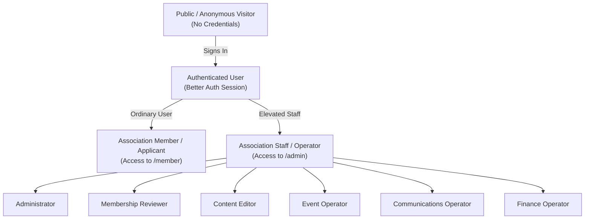
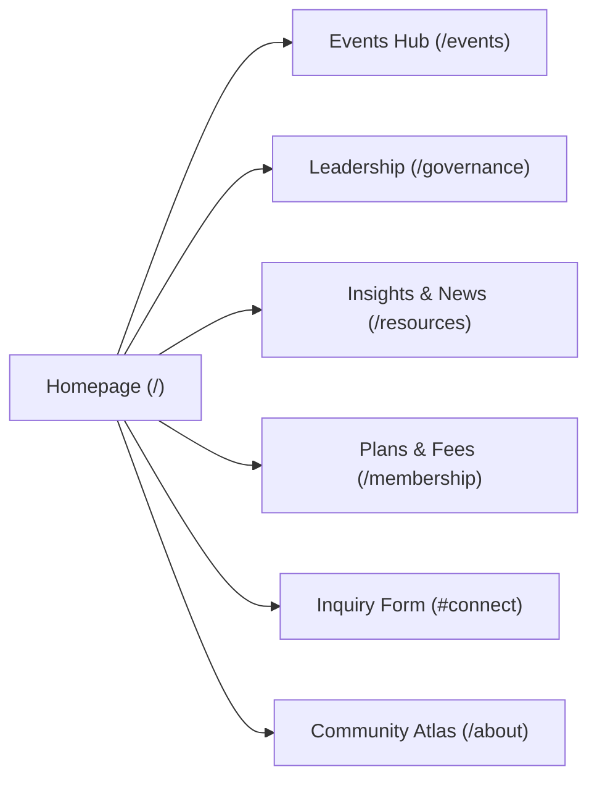
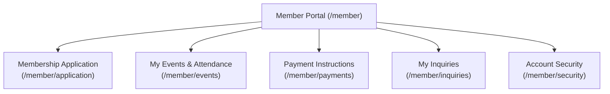
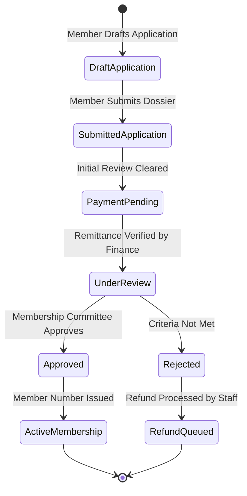

# TPA Platform: Functional Specification & Business Architecture
**Tollygunge Professional Association (TPA)**  
*Document Version:* 1.0.0 | *Last Updated:* 2026-11-01  
*Audience:* Association Leadership, Product Managers, Operations Teams, Domain Specialists

---

## 1. Executive Summary & Association Mission

The **Tollygunge Professional Association (TPA)** is a premier multidisciplinary professional organization headquartered in South Kolkata. Unlike single-discipline associations (such as pure CA study circles), TPA unites professionals across interrelated domains:
- **Chartered Accountants (CA)**
- **Company Secretaries (CS)**
- **Cost and Management Accountants (CMA)**
- **Advocates & Legal Practitioners**
- **Corporate Executives & Financial Consultants**
- **Academics & Aspiring Students**

The **TPA Digital Platform** serves as the central operational backbone and public interface for the association, facilitating continuous professional education, accredited symposiums, transparent governance, member onboarding, and administrative coordination.

---

## 2. Stakeholder Personas & Access Hierarchies

### 2.1 Persona Definitions & Functional Scope

| Persona | Entry Route | Functional Scope & Daily Tasks |
|---|---|---|
| **Public Visitor** | `/`, `/events`, `/about` | Explores public events, reads published articles/news, accesses governance directories, submits inquiries, subscribes to newsletters. |
| **Prospective Applicant** | `/join`, `/member/application` | Submits membership drafts, uploads identity proofs and professional certificates, tracks application vetting status. |
| **Registered Member** | `/member`, `/account` | Manages professional profile, books free/paid event seats, accesses event QR entry badges, views active bank/UPI instructions, tracks attendance history. |
| **Content Editor** | `/admin/workspaces/content` | Drafts and publishes news insights, updates static page sections, manages editorial media and image galleries. |
| **Event Operator** | `/admin/workspaces/events` | Schedules conferences, defines venue/seat capacities, designs downloadable flyers (PNG/PDF), marks physical attendee check-ins. |
| **Communications Operator**| `/admin/workspaces/crm` | Manages inbound public inquiries, assigns follow-ups to staff, writes internal CRM notes, composes email broadcasts. |
| **Membership Reviewer** | `/admin/workspaces/members` | Vets submitted applications, verifies uploaded qualification documents, processes bulk member CSV rosters. |
| **Finance Operator** | `/admin/workspaces/payments` | Maintains official bank account details, configures UPI IDs, uploads verified payee QR snapshots, generates reconciliation exports. |
| **Super Administrator** | `/admin/workspaces/access` | Assigns and revokes staff roles, inspects tamper-proof audit trails, governs platform configuration. |

---

## 3. Public Discovery & Experience Portal

### 3.1 Public Portal Modules
1. **Interactive Homepage (`/`)**:
   - **Hero Section**: Association identity, mission statement, and quick calls-to-action ("Explore Events", "Apply for Membership").
   - **Upcoming Highlights**: Dynamic carousel of forthcoming seminars and workshops.
   - **Community Atlas**: Visual representation of regional professional hubs and chapters.
   - **Public Inquiry Intake (`#connect`)**: Anti-spam protected inquiry form with automated honeypot and rate limiting.
   - **Newsletter Double Opt-In**: Compliant email subscription flow with tokenized confirmation links.
2. **About & Governance (`/about`, `/governance`)**:
   - Historical background of TPA.
   - Founding members and visionary leadership.
   - Executive Committee and Sub-Committee profiles with verified portrait imagery and professional credentials.
3. **Events Hub (`/events`, `/events/[id]`)**:
   - Public listing of past and upcoming professional development sessions.
   - Detailed event itineraries, venue directions, and speaker profiles.
   - Direct seat booking for authenticated members or public registration (when open).
4. **Resources & Attributed News (`/resources`, `/resources/[slug]`)**:
   - Technical papers, budget analyses, tax circular summaries, and regulatory updates.
   - **Attributed News**: Editorial news digests referencing verified source publications with clear provenance attribution.

---

## 4. Member Self-Service Portal (`/member`)

Upon logging in, members are directed to their personal workspace with a dedicated account navigation header:

### 4.1 Functional Workflows
1. **Resumable Membership Application (`/member/application`)**:
   - Multi-step application draft allowing applicants to save progress and return later.
   - Automatic postal lookup: entering a 6-digit PIN code auto-populates district and state from the reference directory.
   - Document Uploads: Securely upload government identity proof (Aadhaar/PAN) and professional membership certificates (ICAI, ICSI, Bar Council). Uploads are private and inaccessible to public readers.
2. **Event Participation & QR Entry (`/member/events`)**:
   - View registered upcoming events.
   - Access dynamic, mobile-optimized QR entry passes for instant venue check-in.
   - Download event presentation slides and reference materials post-session.
   - Historical attendance records documenting participation in association symposiums.
3. **Official Payment Instructions (`/member/payments`)**:
   - Access verified, active association banking details.
   - Scan approved UPI QR codes directly from the screen for fee remittances.
   - View instructions for submitting payment reference numbers (UTR) to staff.
4. **Account & Security (`/member/security`, `/account/profile`)**:
   - Self-service contact information and bio updates.
   - Secure password change interface with password-strength enforcement.
   - Active session view with ability to log out of other devices.

---

## 5. Administrative Operational Workspaces (`/admin`)

The operational control center is divided into focused workspaces enforcing strict role separation:

```mermaid
graph TD
    AdminCenter["Admin Control Center (/admin)"]
    
    AdminCenter --> WS_Content["CMS Content Workspace\n(Content Editor)"]
    AdminCenter --> WS_Media["Editorial Media\n(Content Editor)"]
    AdminCenter --> WS_Events["Events & Flyers\n(Event Operator)"]
    AdminCenter --> WS_EventOps["Live Attendance & Check-in\n(Event Operator)"]
    AdminCenter --> WS_Members["Member Directory & Vetting\n(Membership Reviewer)"]
    AdminCenter --> WS_Imports["Bulk Data Import Jobs\n(Membership Reviewer)"]
    AdminCenter --> WS_CRM["CRM Inquiries & Follow-ups\n(Communications Operator)"]
    AdminCenter --> WS_Comms["Email Broadcast Campaigns\n(Communications Operator)"]
    AdminCenter --> WS_Payments["UPI & Bank Instructions\n(Finance Operator)"]
    AdminCenter --> WS_Access["Staff Roles & Security\n(Administrator)"]
    AdminCenter --> WS_Audit["Global Audit Trail\n(Administrator)"]
    AdminCenter --> WS_Reports["Scoped Reports & Exports\n(Role-Scoped)"]
```

### 5.1 Deep-Dive into Core Operational Workspaces

#### 1. CMS Content & Editorial Media Workspace
- **Draft vs. Published Snapshots**: Authors can draft and edit articles without affecting the live public website.
- **Rich Text Experience**: Powered by Tiptap with structured support for tables, blockquotes, code blocks, and formatted lists.
- **Media Ingestion**: Image uploads are automatically re-encoded to WebP format, stripped of location metadata (EXIF), and assigned accessible alt text.

#### 2. Event Management & Live Operations
- **Capacity Serialization**: Configurable attendee quotas prevent overbooking using database row locks.
- **Automated Flyer Generator**: Generates professional event flyers for 1- or 2-speaker panels, complete with auto-generated registration QR codes, downloadable as PNG or vector PDF.
- **Live Check-in Console**: Operators use a high-speed camera QR scanner or search interface to record physical attendance in real time.

#### 3. Membership Review & Bulk Import Engine
- **Application Dossier Review**: Reviewers inspect applicant qualifications and zoom into private verification documents via short-lived, audited viewing links.
- **Bulk Import Jobs**: Asynchronously ingest legacy member spreadsheets. If data errors occur (e.g., malformed phone numbers or duplicate emails), the system produces an annotated **Correction Excel Workbook** pinpointing the exact cells requiring fixes.

#### 4. CRM Inquiries & Communication Campaigns
- **Inquiry Pipeline**: Triage public inquiries through states: `New` ➔ `Contacted` ➔ `Closed`.
- **Internal Collaboration**: Staff can record private notes and reassign inquiries to colleagues; internal notes are never exposed to the public submitter.
- **Targeted Broadcasts**: Draft communication templates, preview merged recipient variables, and queue broadcasts through the background worker.

#### 5. Payment Governance Workspace
- **Instruction Lifecycle**: Bank details and UPI QR records move through `Draft` ➔ `Active` ➔ `Past` states.
- **Payee Confirmation Guard**: Activating a payment instruction requires explicit confirmation of the payee name to prevent accidental or fraudulent misdirection of member dues.

#### 6. Access Control & Immutable Audit Trails
- **Granular Delegation**: Administrators assign specific operational roles without granting global superuser access.
- **Instant Revocation**: Modifying a staff role instantly invalidates active browser sessions for that user.
- **Tamper-Proof Audit History**: Every published article, role change, document download, and status update is immutably logged with actor ID, timestamp, and diff metadata.

---

## 6. Core Business Rules & Association Governance Safeguards

### 6.1 Foundational Invariants

1. **State Independence**:
   - `Application State` (Draft, Submitted, Under Review, Approved, Rejected)
   - `Payment State` (Unpaid, Remitted, Verified, Refunded)
   - `Membership State` (None, Active, Suspended, Expired)
   *Rule: No state is ever automatically inferred from another. A payment does not guarantee membership approval, and submitting an application does not create a member number.*

2. **Zero Autonomous Privilege Escalation**:
   - No public sign-up, Google OAuth login, or profile update can grant staff permissions.
   - Staff roles require explicit administrator assignment stored in `tpa.staff_roles`.

3. **Physical Attendance vs. Learning Hours**:
   - Event check-in verifies physical or virtual presence.
   - Accredited CPE/learning hours are **not** automatically granted upon check-in; they require formal committee review and certification in accordance with professional institute guidelines.

4. **Document Privacy & Data Protection**:
   - Member qualification documents and identity cards are stored in private Cloudflare R2 buckets.
   - Documents are never indexed by search engines and cannot be accessed via public URLs.
   - Staff access to private documents generates a traceable audit record.

5. **Attributed Editorial News Standard**:
   - All news published under TPA Insights must have an explicit source citation, author/editor attribution, and canonical link to prevent plagiarism and ensure intellectual integrity.

