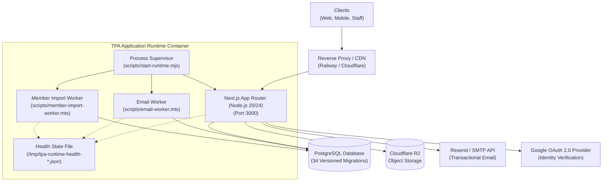
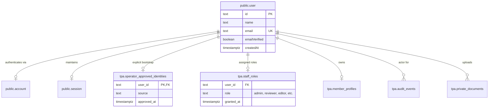
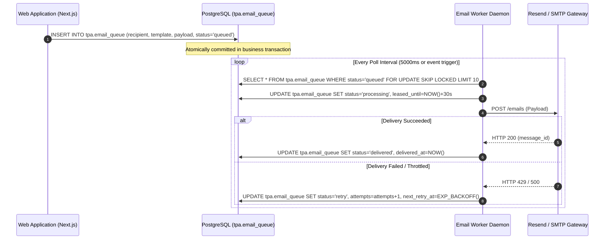

# TPA Platform: Technical Architecture & System Design
**Tollygunge Professional Association (TPA)**  
*Document Version:* 1.0.0 | *Last Updated:* 2026-11-01  
*Audience:* Software Engineers, System Architects, Security Auditors, Technical Leads

---

## 1. Executive Technical Overview

The **Tollygunge Professional Association (TPA) Platform** is an enterprise-grade web application and operational infrastructure designed for an interdisciplinary professional body (encompassing Chartered Accountants, Company Secretaries, Legal Professionals, Corporate Executives, and Academics).

The architecture is built upon a **unified, multi-runtime Next.js and Node.js monolithic architecture** that eliminates distributed-system fragility while enforcing strict boundaries between:
- **Public Interactive Experience**: High-performance, SEO-optimized App Router presentation layer with server-rendered pages and dynamic header personalization.
- **Member Self-Service Portal**: Secure account workspace (`/member`) for membership applications, event registrations, attendance records, document uploads, and payment instruction verification.
- **Role-Based Staff Operations (`/admin`)**: Granular operational command center with six distinct permission workspaces, optimistic concurrency control, and transactional audit logging.
- **Background Worker Subsystems**: Dedicated background processes for durable transactional email dispatch (`email-worker`) and asynchronous bulk member import reconciliation (`member-import-worker`), managed by a resilient Node.js process supervisor (`scripts/start-runtime.mjs`).



---

## 2. Technology Stack & Runtime Topology

| Layer / Concern | Technology Selection | Version / Specification | Rationale & Architectural Constraints |
|---|---|---|---|
| **Core Framework** | Next.js (App Router) | `^16.3.8` | React Server Components (RSC), standalone Docker bundling, streaming layouts, and type-safe server actions. |
| **UI Library** | React & React DOM | `^19.3.0` | React 19 concurrent features, enhanced Server Actions, and native asset preloading. |
| **Language & Tooling**| TypeScript, Node.js | TS `^6.0.3`, Node `20.x` / `24.x` | Strict type validation, zero runtime type overhead, modern ESM module execution. |
| **Primary Database** | PostgreSQL | `17.x` / `18.x` | Robust ACID transactions, JSONB indexing, advisory locks (`pg_advisory_lock`), and row-level locking (`SKIP LOCKED`). |
| **Authentication** | Better Auth | `1.7.7` | Database-backed session persistence, credential hashing (`scrypt`), disabled cookie caching to force revocation checks. |
| **Object Storage** | Cloudflare R2 via AWS SDK | `@aws-sdk/client-s3 ^3.1146.0` | S3-compatible private document storage; zero egress fees; presigned URLs with 60-second validity. |
| **Worker Bundler** | esbuild | `0.28.2` | Ultra-fast standalone compilation of TypeScript background workers into ES modules (`.next/*.mjs`). |
| **Rich Text Editor** | Tiptap (ProseMirror) | `3.31.4` | Structured document AST, server-side HTML/text serialization, and sanitized CMS publishing. |
| **Animations & Smooth Scroll** | GSAP & Lenis | GSAP `^3.15.0`, Lenis `1.3.27` | High-fidelity, accessible motion physics with strict reduced-motion fallbacks. |
| **Email Dispatch** | Resend SDK & Nodemailer | Nodemailer `^10.0.14`, Svix `2.8.0` | Multi-provider strategy: Resend API for production delivery; local SMTP / Mail Sink for isolated automated testing. |
| **Image Processing** | Sharp | `^0.35.5` | Format validation, EXIF metadata stripping, WebP conversion, dimension bounding to eliminate image payload attacks. |
| **Document/PDF Generation** | jsPDF & QRCode | jsPDF `^4.2.1`, qrcode `^1.5.4` | In-memory canvas rendering for dynamic event flyers and verification QR badges. |

---

## 3. Directory Layout & Architectural Responsibilities

The codebase enforces a verified repository boundary policy verified by `scripts/check-repository-structure.mjs`:

```text
├── src/
│   ├── app/                 # Next.js App Router: routes, layouts, page views, and API handlers
│   │   ├── (public pages)   # /, /about, /governance, /membership, /events, /resources, /contact
│   │   ├── account/         # Smart role-based entry point (/account) and personal profile (/account/profile)
│   │   ├── member/          # Authenticated member portal (application, events, payments, inquiries)
│   │   ├── admin/           # Authenticated staff operational workspaces (/admin/workspaces/*)
│   │   ├── preview/admin/   # Synthetic client demonstration workspace (isolated, read-only mocks)
│   │   ├── flyers/[id]/     # Dynamic flyer generator route (PNG/PDF export)
│   │   ├── media/[id]/      # Normalized public editorial media delivery
│   │   ├── downloads/[id]/  # Private document download route (temporary presigned issuance)
│   │   └── api/             # HTTP boundary: /api/auth, /api/staff/*, /api/member/*, /api/health
│   ├── components/          # Reusable React components (SiteShell, AccountShell, Workspaces, Editors)
│   ├── domain/              # Pure business rules, domain types, validations, and permission policies
│   └── lib/                 # Server integrations: PostgreSQL pool, Better Auth, R2 storage, email adapters
├── scripts/                 # Operational tools, CLI runners, background workers, and build scripts
│   ├── run.sh               # Unified CLI orchestration runner
│   ├── start-runtime.mjs    # Production multi-process supervisor
│   ├── email-worker.mts     # Queue-driven email delivery background daemon
│   ├── member-import-worker.mts # Background import reconciler
│   ├── migrate.mjs          # Transactional checksummed migration engine
│   └── check-repository-structure.mjs # Repository placement guard
├── migrations/              # Ordered, checksummed SQL migrations (001_*.sql to 034_*.sql)
├── data/postal/             # Verified postal directory and PIN code reference data
├── docs/                    # Technical architecture, runbooks, and functional specifications
└── tests/                   # Automated test suites (unit, db integration, HTTP integration, Playwright)
```

---

## 4. Multi-Tier Security, Authentication & Authorization Model

### 4.1 Authentication & Identity Links

User authentication is decoupled from association membership and operational roles:



1. **Better Auth Engine**: Uses PostgreSQL tables (`public.user`, `public.session`, `public.account`). Sessions are re-verified on every request against the database; in-memory/cookie session caching is explicitly disabled to ensure immediate session termination upon role revocation.
2. **Operator-Approved Identity Gate (`tpa.operator_approved_identities`)**: Public signup cannot grant elevated privileges. Non-OAuth accounts require either verified email deliverability or an explicit record in `tpa.operator_approved_identities` created by an offline administrative script.
3. **Session Revocation Pipeline**: When an administrator updates or revokes a staff role, the action executes inside a PostgreSQL transaction advisory lock (`pg_advisory_xact_lock`), updates `tpa.staff_roles`, and atomically deletes all active sessions from `public.session` for that user, instantly terminating unauthorized sessions.

### 4.2 Role-Based Access Control (RBAC) Architecture

TPA implements a zero-trust server-side authorization layer (`src/domain/access.ts` and `src/lib/actor.ts`). Client payloads, cookies, or UI routes never determine access. 

The system defines six discrete, orthogonal operational roles:

| Operational Role | Permitted Workspace & Handlers | Capability Matrix |
|---|---|---|
| `administrator` | `/admin/workspaces/access`, `/admin/workspaces/audit` | Full system governance, role assignment, session revocation, global audit trail review. |
| `membership_reviewer` | `/admin/workspaces/members`, `/admin/workspaces/imports` | Review member applications, verify credentials, view private documents, execute import reconciliation. |
| `content_editor` | `/admin/workspaces/content`, `/admin/workspaces/media` | Create CMS drafts, preview unpublished content, publish/unpublish articles, manage editorial media. |
| `event_operator` | `/admin/workspaces/events`, `/admin/workspaces/event-operations` | Create events, manage seat quotas, design flyers (jsPDF), mark live physical check-ins. |
| `communications_operator` | `/admin/workspaces/crm`, `/admin/workspaces/communications` | Manage public inquiries, assign CRM follow-ups, draft email campaigns, inspect consent logs. |
| `finance_operator` | `/admin/workspaces/payments` | Maintain bank payment instructions, manage UPI IDs, upload verified payee QR snapshots, activate payment configurations. |

---

## 5. Data Layer & Schema Design

### 5.1 Database Migrations Engine (`scripts/migrate.mjs`)
- **Ordered SQL Migrations**: 34 SQL files in `migrations/` applied sequentially.
- **SHA-256 Checksum Verification**: Every migration's content is hashed; if an already-applied migration file is altered, the migration runner halts immediately.
- **Advisory Locks**: The runner acquires an exclusive advisory lock (`pg_advisory_lock(894212036)`) to ensure single-instance migration execution during deployments.
- **Database Identity Matching**: Verifies `current_database()` against `process.env.TPA_DATABASE_NAME` to prevent catastrophic migration execution against the wrong environment.

### 5.2 Concurrency & State Management
- **Optimistic Version Locking**: Tables subject to concurrent editorial updates (`tpa.website_pages`, `tpa.payment_details`, `tpa.inquiries`) maintain integer `version` columns. Updates assert `WHERE id = $1 AND version = $2`, rejecting stale saves with HTTP 409 Conflict.
- **Pessimistic Row Locking (`FOR UPDATE`)**: Event seat registrations and cancellations acquire row-level locks on the target event to serialize concurrent capacity decrement/increment.
- **Advisory Transaction Locks**: Sensitive administrative actions (role replacement, admin provisioning) serialize under explicit `pg_advisory_xact_lock` IDs.

### 5.3 Immutable Audit Logging (`tpa.audit_events`)
All consequential state mutations write an immutable row to `tpa.audit_events` within the same database transaction:
- `actor_user_id`: Foreign key to `public.user`.
- `action`: Canonical action identifier (e.g., `content.published`, `staff.role_assigned`, `payment_details.activated`).
- `entity_id`: UUID of the affected entity.
- `metadata`: JSONB snapshot of change diffs or state transitions (excluding raw credentials or secret tokens).
- Keyset-paginated queries ensure constant-time audit history inspection regardless of table scale.

---

## 6. Background Worker & Concurrency Subsystem



### 6.1 Multi-Process Runtime Supervisor (`scripts/start-runtime.mjs`)
In production containers, the runtime entry point is not raw Next.js, but a resilient Node.js supervisor:
1. **Isolated Child Process Spawning**:
   - Spawns `server.js` (Next.js standalone HTTP server).
   - Spawns `email-worker.mjs` (transactional email dispatcher).
   - Spawns `member-import-worker.mjs` (bulk CSV import processor).
2. **Environment Variable Scoping**:
   - Strip sensitive database credentials (`TPA_EMAIL_DATABASE_URL`, `TPA_IMPORT_DATABASE_URL`) from sibling processes so each worker receives only its designated database credentials.
3. **Fault-Tolerant Auto-Restart**:
   - If a background worker crashes (e.g., due to an unhandled exception or upstream timeout), the supervisor catches the process exit and restarts the worker with exponential backoff (`5s`, `10s`, `20s`, max `60s`).
   - Web server process remains uninterrupted during worker restarts.
4. **IPC Health Telemetry**:
   - The supervisor and workers periodically write status heartbeats to `/tmp/tpa-runtime-health-${PORT}.json` using atomic file rename operations (`0o600` permissions).
   - The `/api/health` HTTP endpoint reads this telemetry to report comprehensive container readiness.

### 6.2 Email Worker Architecture (`scripts/email-worker.mts`)
- Utilizes `FOR UPDATE SKIP LOCKED` queries on `tpa.email_queue` to permit horizontal worker scaling without dual-delivery races.
- Supports three dispatch modes:
  - **Resend REST API**: Primary cloud delivery mechanism with signed webhook validation (`Svix`).
  - **SMTP Gateway**: Standard TLS transactional dispatch.
  - **Loopback Mail Sink (`TPA_MAIL_SINK=true`)**: Captures messages in memory/database for automated end-to-end integration testing without external network traffic.

### 6.3 Bulk Member Import Worker (`scripts/member-import-worker.mts`)
- Processes multi-thousand-row member rosters asynchronously.
- Validates data against the postal reference directory (`data/postal/`).
- Identifies duplicates, ambiguous identities, and missing mandatory fields.
- Generates downloadable correction Excel workbooks (`exceljs`) containing specific row-level validation errors, allowing operators to correct and re-upload data cleanly.

---

## 7. Storage Architecture & Image Processing Pipeline

The platform uses **Cloudflare R2** (S3-compatible API via `@aws-sdk/client-s3`) configured with private access:

```mermaid
flowchart LR
    UploadClient["Client Browser"] -->|Multipart Form| APIServer["Next.js API Handler\n(/api/documents or /api/staff/media)"]
    
    subgraph InspectionPipeline ["In-Memory Pipeline (Sharp)"]
        MagicBytes["Magic Byte / MIME Check"] --> Decode["Full Image Decode"]
        Decode --> StripEXIF["Strip EXIF & Geo Metadata"]
        StripEXIF --> Normalize["Resize & WebP Re-encoding"]
    end

    APIServer --> InspectionPipeline
    Normalize -->|PutObjectCommand| R2Bucket[("Private Cloudflare R2 Bucket\ntpa-private-documents")]
    
    R2Bucket -.->|Presigned 60s GET URL| AuthorizedReader["Authorized Reader\n(Audited Download)"]
```



### 7.1 Private Documents vs. Public Media Segregation
1. **Private Member Documents** (`tpa.private_documents`):
   - Scope: Identity proofs, qualification certificates, member photos.
   - Storage Key: `tpa/private/documents/{userId}/{uuid}`.
   - Access: Zero public URLs. Accessible strictly via authenticated route `/downloads/[id]`, which verifies user ownership or `membership_reviewer` permission, logs an audit entry, and generates a presigned URL expiring in 60 seconds (`no-store` headers).
2. **Editorial Media** (`tpa.public_media`):
   - Scope: CMS article hero images, event banners, governance portraits.
   - Storage Key: `tpa/editorial/media/{uuid}.webp`.
   - Pipeline: All uploads pass through Sharp in-memory: checked for pixel dimension limits, EXIF/GPS tags stripped, and converted to optimized WebP.
   - Delivery: Served via `/media/[id]`. Requires an explicit published snapshot in `tpa.public_media`. Unpublishing an asset immediately blocks future public reads.

---

## 8. External Integrations & Boundaries

1. **Google OAuth 2.0**:
   - Integrated via Better Auth. Maps external sub claims to local `public.user` records.
   - Redirect URIs strictly enforced to origin (`/api/auth/callback/google`).
2. **Postal Directory Integration (`data/postal/`)**:
   - Pre-packaged reference database containing all Indian PIN codes, districts, and postal circles.
   - Resolves state and district automatically from PIN code entries during member onboarding, eliminating typo errors.
3. **Webhook Verification (Svix)**:
   - Resend inbound email delivery webhooks are validated using cryptographic signatures via Svix headers (`svix-id`, `svix-timestamp`, `svix-signature`).

---

## 9. Architectural Invariants (Must Never Be Broken)

1. **No Client-Side Authorization**: UI hiding is cosmetic; all `/api/*` handlers and Server Actions must invoke `requireActor()` and verify database-backed roles.
2. **Payment Separation**: A saved payment draft or QR display is not a confirmed financial transaction. No order or membership activation is inferred without explicit finance operator confirmation.
3. **Application Draft Isolation**: A membership application in `draft` state belongs exclusively to its author. It cannot be viewed by reviewers until submitted.
4. **Single-Use Password Tokens**: Password reset tokens expire in 15 minutes, are single-use, and automatically revoke all existing sessions upon successful consumption.
5. **No Production Secrets in Git**: Local execution uses `.env.local`; all cloud credentials must be supplied via Railway environment secrets.

